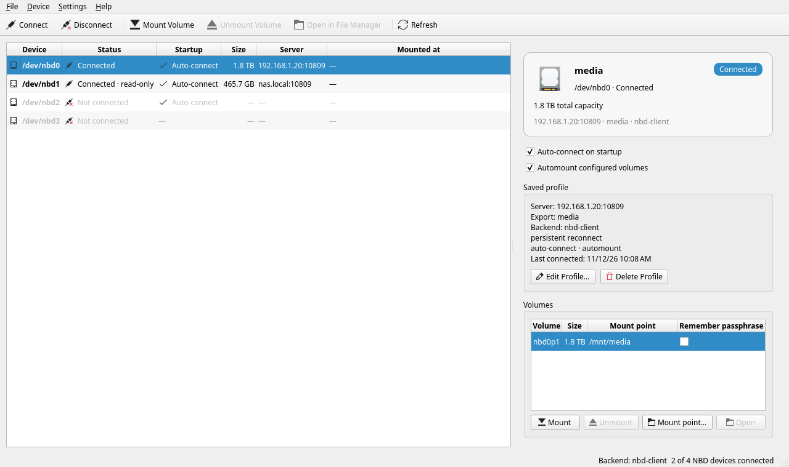
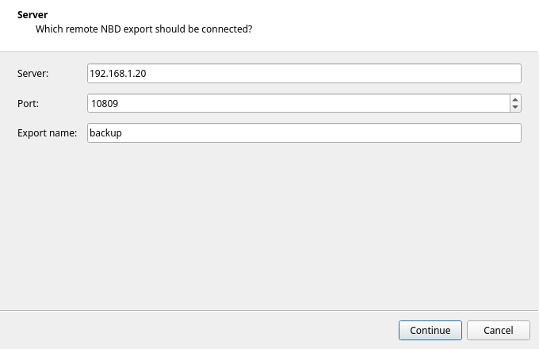

# NBDisk

NBDisk is a Qt 6 / KDE Frameworks 6 desktop client for Linux that connects
remote Network Block Device (NBD) exports to local `/dev/nbd*` devices and
mounts the resulting volumes. It is a graphical front end for `nbd-client` and
`qemu-nbd`, with saved connection profiles, automatic reconnection at login, and
optional passwordless operation through a root helper.

Source code, documentation, and issue tracker:
<https://github.com/liturondev/NBDisk>.

## Contents

- [Features](#features)
- [Screenshots](#screenshots)
- [Requirements](#requirements)
- [Installation](#installation)
- [Usage](#usage)
- [Background service](#background-service)
- [Privileged helper](#privileged-helper)
- [Files, sockets, and environment](#files-sockets-and-environment)
- [Troubleshooting](#troubleshooting)
- [Limitations](#limitations)
- [Development](#development)
- [License](#license)

## Features

- Lists every NBD device exposed by the kernel, including devices connected by
  other tools.
- Connects and disconnects exports through either `nbd-client` or `qemu-nbd`.
- Shows connection status, capacity, server/export, and volume state in a disk
  card with per-volume usage bars.
- Mounts and unmounts volumes with `udisksctl` by default, or mounts at
  configured per-volume mount points through `pkexec` and `mount`.
- Detects LUKS-encrypted volumes and can unlock or lock them with `cryptsetup`.
- Saves a connection profile for each NBD device, with optional auto-connect,
  automount, and per-volume mount-point settings. Profiles can be edited or
  deleted from the disk card and are also available from the device context
  menu.
- Remembers LUKS passphrases in KDE Wallet, so encrypted volumes can be unlocked
  automatically when a profile reconnects.
- Ships `nbdisk-daemon`, a headless background service that reconnects saved
  disks and mounts configured volumes at login without opening the window.
- An optional `nbdisk-helper` root service accepts only validated, high-level
  operations over a group-restricted Unix socket, removing the repeated password
  prompts from login-time reconnects, LUKS unlocks, and mounts.
- Refreshes the device list automatically and remembers the window layout.

## Screenshots



*The main window: device list, disk card with a saved profile, and volume
controls.*



*The connect wizard, with the server, export, and port for a new connection.*

## Requirements

Runtime:

- Linux with the `nbd` kernel module
- At least one backend:
  - `nbd-client`, which supports block size, request timeout, persistent
    reconnect, and TLS
  - `qemu-nbd`, for basic connections and read-only mode
- `pkexec` from polkit for privileged connect, disconnect, module-load, and LUKS
  commands
- `udisksctl` from udisks2 for default mounting and unmounting
- `mount` from util-linux and `mkdir` from coreutils for configured mount points
- `lsblk` from util-linux for LUKS volume detection
- `cryptsetup` for unlocking and locking LUKS volumes
- KWallet (the standard KDE Wallet) to remember LUKS passphrases
- `modprobe` from `kmod` to load the `nbd` module on demand
- systemd to run the optional `nbdisk-helper` service; without it, privileged
  steps use interactive `pkexec` prompts

Build:

- CMake 3.20 or newer, Ninja (or another generator), and a C++20 compiler
- Qt 6.5 or newer: Widgets, DBus, Network, Xml, Test
- KDE Frameworks 6: Config, ConfigWidgets, CoreAddons, I18n, Wallet,
  WidgetsAddons, XmlGui

On Debian/Ubuntu the build dependencies are typically:

```sh
sudo apt install cmake ninja-build g++ qt6-base-dev qt6-base-dev-tools \
    libkf6config-dev libkf6configwidgets-dev libkf6coreaddons-dev \
    libkf6i18n-dev libkf6wallet-dev libkf6widgetsaddons-dev libkf6xmlgui-dev
```

Install `nbd-client` or `qemu-utils`, plus `udisks2`, `cryptsetup`, and
`polkit-kde-agent-1` at runtime.

## Installation

### Arch Linux package

A local-source PKGBUILD is available in `packaging/arch`. It packages the source
tree it lives in, so build it from that directory:

```sh
cd packaging/arch
makepkg -si
```

The package is named `nbdisk`. Its install script creates the `nbdisk` group if
needed, enables `nbdisk-helper.service`, and adds the user that invoked `pacman`
(via `sudo` or `pkexec`) to the `nbdisk` group. That group membership applies
after the next login. At least one of the optional `nbd` or `qemu-img` packages
is needed at runtime, and a polkit agent such as `polkit-kde-agent` should be
running for graphical authentication.

Removing the package disables the helper service and removes its members from
the `nbdisk` group.

### Debian and RPM packages

`debian/` builds a Debian binary package from this tree, and
`packaging/fedora/nbdisk.spec` builds an RPM for Fedora and openSUSE Tumbleweed.
Both read the version from `CMakeLists.txt` through their tooling (the spec takes
it from CI with `--define`). The exact dependency lists live in
`.github/ci/install-deps.sh`; inside a matching container the builds are:

```sh
# Debian and Ubuntu
dpkg-buildpackage -b -us -uc

# Fedora and openSUSE (needs dist/nbdisk-<version>.tar.gz as Source0)
rpmbuild -bb packaging/fedora/nbdisk.spec
```

Every push and pull request runs the [`Build`](.github/workflows/build.yml)
workflow: it compiles and tests NBDisk on Debian, Ubuntu, Fedora, and openSUSE
Tumbleweed, then uploads the Arch, Debian, and RPM packages as workflow
artifacts. Arch Linux is covered once, by the package job, because `makepkg`
runs the test suite while building.

### Releases

Pushing a version tag is all a release needs: the tag is the version, and the
packaging scripts pass it to CMake and to makepkg, debhelper, and rpmbuild, so
no file has to be bumped first. The
[`Release`](.github/workflows/release.yml) workflow builds the Arch, Debian,
and RPM packages at that tag and attaches them to a GitHub release:

```sh
git tag -s v0.2.0 -m "v0.2.0"
git push origin v0.2.0
```

Release tags are GPG-signed, so GitHub marks them as verified and users can
check them with `git tag -v v0.2.0`. The signing key is the maintainer's, and
`git config tag.gpgSign true` makes a plain `git tag v0.2.0` sign as well. The
workflow's first job asks GitHub whether the pushed tag carries a verified
signature and fails before building anything otherwise, so an unsigned tag
pushed from another machine cannot publish a release.

`NBDISK_VERSION` in `CMakeLists.txt` is only the fallback used by untagged
branch builds, so bump it when `main` should report an upcoming version. The
release history in `data/io.github.liturondev.NBDisk.metainfo.xml` is still
written by hand. To package a version locally, pass it to the scripts:
`NBDISK_VERSION=0.2.0 .github/ci/package-deb.sh`.

### Build from source

```sh
cmake -B build -G Ninja -DCMAKE_BUILD_TYPE=Release
cmake --build build
ctest --test-dir build --output-on-failure
```

Run without installing:

```sh
./build/nbdisk
```

Install system-wide:

```sh
sudo cmake --install build
```

That installs `nbdisk`, `nbdisk-daemon`, and `nbdisk-helper` into
`${CMAKE_INSTALL_BINDIR}`, the systemd unit, the sysusers configuration, the
desktop file, the AppStream metainfo, the icon, and the XMLGUI resource file.

### Enabling the privileged helper

The helper is optional. To enable the passwordless path after installing from
source:

```sh
sudo systemctl enable --now nbdisk-helper.service
sudo usermod -aG nbdisk "$USER"
# log out and back in so the new group membership applies
```

Packages apply `data/sysusers/nbdisk.conf` automatically. When installing from
source without systemd-sysusers, create the group first:

```sh
sudo groupadd -r nbdisk
```

## Usage

### Connecting a disk

**File > Connect…** (or the Connect toolbar button) opens a three-step wizard:

1. **Server** — the host name or IP address, the port (default `10809`), and the
   export name. Leave the export empty to ask the server for its default export.
2. **Local Device** — the `/dev/nbd*` device the export should be attached to.
   Only disconnected devices are offered; NBDisk reports when all devices are
   already in use.
3. **Connection** — the backend, the read-only flag, and the advanced tuning.

The wizard offers **Automatic**, `nbd-client`, and `qemu-nbd` when they are
available. Automatic uses `nbd-client` when present and falls back to
`qemu-nbd`. The advanced controls are only enabled for `nbd-client`, because
`qemu-nbd` does not expose those options in its NBD client mode:

- Block size (default 512 bytes)
- Request timeout (0 to 3600 seconds, or no timeout)
- Reconnect automatically after a network interruption
- TLS, with an optional client certificate, private key, CA certificate, and TLS
  host name

Connections made outside NBDisk are shown as external, because their server
details cannot be read from the kernel.

### Disconnecting

**File > Disconnect** stops the selected device. If any volume of that device is
mounted, NBDisk asks first and can unmount the volumes before disconnecting.
Disconnecting also locks any LUKS mappers that NBDisk opened for the device.

### Volumes and mount points

The disk card lists the device's volumes with size, mount point, and remembered
passphrase state. When a device is connected, the volume table has a
**Mount point** column:

- Leave it empty to use the default `udisksctl` behavior.
- Set an absolute path (other than `/`) to have **Mount** create the directory
  with `mkdir -p` and mount there with `mount`. **Mount point…** opens a
  directory picker. Read-only devices are mounted with `-o ro`.

**Open in File Manager** opens the selected volume's mount point. **Unmount**
uses `udisksctl` as the current user and therefore relies on the udisks2 polkit
rules; it does not require `pkexec`.

### Profiles

Each connection setup saves a profile for that local NBD device. Select a device
to see its saved profile in the disk card, including server, export, backend,
connection flags, startup behavior, and the last connection time. The
**Startup** column shows whether an entry is **Manual**, **Auto-connect**, or has
no profile yet.

- **Auto-connect on startup** reconnects the device from its profile when NBDisk
  starts, whenever the `nbd` module is available.
- **Automount configured volumes** mounts every configured, currently unmounted
  volume after the device connects.
- **Edit Profile…** changes any saved field; **Delete Profile** removes the
  profile and its remembered LUKS passphrases. Deleting a profile does not
  disconnect the device.

Both actions are also in the device context menu.

### LUKS volumes

Volumes whose file system is `crypto_LUKS` show a lock icon. Select one and click
**Unlock** to open it as `/dev/mapper/nbdisk-<volume>`. The passphrase is
requested in a password dialog and passed to `cryptsetup` over standard input.
Unlock and lock use `pkexec`, so expect a polkit prompt as well.

Enable **Remember this passphrase for automatic unlock** in the unlock dialog, or
tick **Remember passphrase** for the volume, to store the passphrase in KDE
Wallet. Remembered volumes are unlocked automatically after their profile
reconnects, before configured mount points are mounted. Tick the box again, or
delete the profile, to remove the stored passphrase. Passphrases are kept in the
wallet, never in `connections.json`.

**Lock** is disabled while the volume is mounted; unmount first.

Locked LUKS volumes without a remembered passphrase are skipped during automount
and must be unlocked manually after connecting or after a restart.

### Loading the NBD kernel module

**Device > Load NBD Module** loads the module with `max_part=16` so partition
devices can be created for connected exports. NBDisk loads the module on demand
when it is not active. If it is already loaded with different parameters, NBDisk
does not reload it; reload it manually if no devices appear.

### Connecting to NetworkBlock

NetworkBlock is an Android NBD server that exports each disk image under its
file name. Each running image has its own port.

- **Wi-Fi**: enter the phone's IP address and the port shown for the image.
- **USB**: run `adb forward tcp:<port> tcp:<port>` on the desktop, then use
  `127.0.0.1` as the server and the same port.
- **Export name**: enter the image's file name exactly, for example
  `disk-1.img`. It is case-sensitive.
- **Backend**: leave this on **Automatic**. `nbd-client` supports the full
  advanced options; `qemu-nbd` is enough for a basic connection.

If the module is not loaded yet, use **Device > Load NBD Module** first.

### Starting at login

**Settings > Start at Login** creates or removes an XDG autostart entry at
`$XDG_CONFIG_HOME/autostart/io.github.liturondev.NBDisk.desktop`. The entry runs
`nbdisk-daemon`, not the GUI, so saved disks are reconnected and mounted without
opening the window.

## Background service

`nbdisk-daemon` performs the startup work without a user interface. It loads the
profile store, loads the `nbd` kernel module if needed, reconnects every profile
with **Auto-connect on startup**, unlocks remembered LUKS volumes, then mounts
the volumes of connected profiles that have **Automount configured volumes** and
a mount point set. Devices that are already connected and volumes that are
already mounted are skipped, so it can coexist with a running NBDisk window.

After the startup pass the service stays on the session bus and exposes
`io.github.liturondev.NBDisk.Service` at `/io/github/liturondev/NBDisk/Service`.
**Settings > Background Service…** uses it to show whether a pass is running,
when the last pass ran, how many devices were connected and volumes mounted, and
to trigger another pass on demand.

Use `--once` to run a single pass and exit instead. The exit status is then 0
when every step succeeded (or there was nothing to do) and 1 when a connection
or mount failed. Progress and failures are written to standard error, which ends
up in the session log. A lock file in the application data directory stops two
instances from overlapping, and a pass that takes longer than ten minutes is
abandoned with a failure.

Run it manually for troubleshooting with `./build/nbdisk-daemon`; it uses the
same `connections.json` as the GUI.

If `nbdisk-daemon` is not installed, NBDisk reports that **Start at Login**
cannot create an entry, and the **Background Service** dialog cannot connect.

## Privileged helper

By default, connecting, disconnecting, loading the `nbd` module, and unlocking or
locking LUKS volumes go through `pkexec`, so each one asks for your password.
That is why a login-time reconnect can produce several prompts.

Passwordless operation comes from the optional `nbdisk-helper`. It runs as root from `nbdisk-helper.service`, listens on
`/run/nbdisk/helper.sock` (mode `0660`, group `nbdisk`), and accepts only a fixed
set of high-level operations: load the nbd module, connect, disconnect, unlock
LUKS, lock LUKS, and mount. It builds every command itself, validates all devices
and paths, and never accepts an arbitrary program name, shell command, or argv
list. The GUI and the user-session daemon keep the profile store and wallet; the
helper never reads `connections.json`.

The systemd unit runs the helper under a restricted environment
(`NoNewPrivileges`, `PrivateTmp`, read-only home, `ProtectSystem=full`) with a
private runtime directory. Because it is a root service, it only mounts at mount
points under `/mnt`, `/media`, `/run/media`, or the calling user's own home
directory. A profile whose mount point is somewhere else still works, but falls
back to an authenticated `pkexec mount` for that volume.

Members of the `nbdisk` group can reconnect, unlock remembered volumes, and mount
configured mount points at login without typing their password. If the helper is
not installed, is not running, or the user is not in the group, NBDisk falls back
to the `pkexec` prompts described above. The desktop must still have a running
polkit authentication agent (normally `polkit-kde-authentication-agent-1` under
Plasma) for that fallback path. If NBDisk is started as root, commands run
directly without `pkexec`.

For local development, a helper started by hand can use a different socket:

```sh
sudo NBDISK_HELPER_SOCKET=/tmp/nbdisk.sock ./build/nbdisk-helper
NBDISK_HELPER_SOCKET=/tmp/nbdisk.sock ./build/nbdisk
```

## Files, sockets, and environment

| What | Where |
| --- | --- |
| Profiles and connection history | `$XDG_DATA_HOME/nbdisk/connections.json` |
| Startup lock file | `$XDG_DATA_HOME/nbdisk/startup.lock` |
| Autostart entry | `$XDG_CONFIG_HOME/autostart/io.github.liturondev.NBDisk.desktop` |
| Window layout | Saved by KXmlGui for application `nbdisk` |
| LUKS passphrases | KDE Wallet, folder `NBDisk` |
| Helper socket | `/run/nbdisk/helper.sock` (mode `0660`, group `nbdisk`) |
| Helper service | `nbdisk-helper.service` |
| D-Bus service | `io.github.liturondev.NBDisk.Service` |
| D-Bus object path | `/io/github/liturondev/NBDisk/Service` |

The helper and its clients recognise these environment overrides:

| Variable | Purpose |
| --- | --- |
| `NBDISK_HELPER_SOCKET` | Use a different helper socket path |
| `NBDISK_HELPER_GROUP` | Require a different group for helper access |

Command-line options are deliberately small:

```sh
nbdisk --help
nbdisk --version
nbdisk-daemon [--once]
nbdisk-helper --help
```

## Troubleshooting

**No devices are listed.** Load the module with **Device > Load NBD Module**. If
it is already loaded with a different `max_part`, unload and reload it manually.

**Connect is disabled.** Install `nbd-client` or `qemu-nbd`; the window reports
which backends are missing in the status bar and in the wizard.

**The password prompt appears repeatedly at login.** Enable
`nbdisk-helper.service`, add your user to the `nbdisk` group, then log out and
back in. Until then, every privileged step falls back to `pkexec`.

**The helper rejects the request.** The caller is not in the `nbdisk` group, or
the mount point is outside the allowed roots. Non-standard mount points need the
interactive `pkexec` fallback.

**The desktop asks for authentication but no dialog appears.** Make sure a polkit
authentication agent is running for the session.

**A connection or mount hangs.** A privileged command that does not finish within
two minutes is stopped and reported as a timeout, so a dead server cannot leave
the window permanently busy.

**A disconnected disk is not reconnected automatically.** Auto-connect runs once
per session attempt, from `nbdisk-daemon` at login and from the GUI when it
starts. A failed profile is not retried until the next start; reconnect manually
or use **Settings > Background Service…** to trigger another pass.

## Limitations

- `qemu-nbd` connections are basic: no TLS, timeout, block size, or automatic
  reconnect.
- Auto-connect is attempted once per session: by `nbdisk-daemon` at login and by
  the GUI when it starts, or when the nbd module becomes available later in the
  same session. A failed profile is not retried until the next start.
- Automount attempts each configured volume once per pass. A failed mount is not
  retried automatically. Locked LUKS volumes are skipped unless their passphrase
  is remembered in KDE Wallet.
- LUKS unlock supports passphrase keyslots. Key-file keyslots, detached headers,
  and custom cryptsetup options are not supported.
- Profiles and mount points are tied to the local device path (`/dev/nbd0`,
  `/dev/nbd1`, and so on), not to a server name.
- Custom mount points depend on the kernel and file system supporting the
  requested mount. Missing mount helpers or file system tools cause the mount
  command to fail and report its error.
- Mounting assumes udisks2 can identify the volume's file system. Unusual file
  systems may need manual mounting.
- The privileged helper only mounts under `/mnt`, `/media`, `/run/media`, or the
  user's own home directory; other mount points require the interactive `pkexec`
  fallback.
- The background service runs the startup pass once per instance and then waits
  on the session bus; it does not watch devices, so a connection that drops later
  is not re-established until the next startup pass or a manual reconnect.
- There is no tray icon; the main window is the only GUI.

## Development

The project uses CMake with Ninja and C++20. All targets share the following
conventions: Qt widgets, KDE Frameworks 6, and `QT_NO_CAST_FROM_ASCII` so that
string conversions stay explicit.

Source layout:

| Path | Contents |
| --- | --- |
| `src/main.cpp` | GUI entry point and application metadata |
| `src/mainwindow.*` | Main window, actions, autostart, and profile commands |
| `src/nbddevicemodel.*` | Device list model |
| `src/devicedetailswidget.*` | Disk card, volume table, and LUKS controls |
| `src/connectdialog.*` | Connect/edit wizard |
| `src/unlockdialog.*` | LUKS passphrase dialog |
| `src/nbdservice.*` | Backend detection, profiles, and privileged operations |
| `src/nbdcommand.*` | `nbd-client` / `qemu-nbd` command construction |
| `src/nbddevice.h` | Device and volume types |
| `src/secretstore.*` | KWallet-backed passphrase storage |
| `src/daemon.cpp` | `nbdisk-daemon` entry point |
| `src/backgroundservice.*` | D-Bus service behind the daemon |
| `src/startuprunner.*` | Login-time reconnect and automount work |
| `src/backgroundserviceclient.*` | Client for the daemon's D-Bus service |
| `src/helper_main.cpp` | `nbdisk-helper` entry point |
| `src/helperserver.*` | Privileged socket server and command building |
| `src/helperclient.*` | Client side of the helper protocol |
| `src/helperprotocol.h` | Shared socket path and protocol constants |
| `data/` | Desktop file, AppStream metadata, icon, systemd unit, sysusers |
| `packaging/arch/` | Local-source PKGBUILD and install script |
| `packaging/fedora/nbdisk.spec` | Portable RPM spec for Fedora and openSUSE |
| `debian/` | Debian packaging: control, rules, copyright, changelog |
| `.github/ci/` | Per-distribution dependency and packaging scripts |
| `.github/workflows/build.yml` | CI: build, test, and package on five distributions |
| `tests/` | Command-builder, service, and startup-runner tests |

Run the test suite:

```sh
ctest --test-dir build --output-on-failure
```

The tests cover command construction for both backends, profile serialisation,
the service's validation and mount-point handling, and the startup runner. They
do not touch real NBD devices and do not require root.

## License

NBDisk is licensed under the GNU General Public License, version 3 or later. See
[LICENSE](LICENSE).

NBDisk is maintained by [liturondev](https://github.com/liturondev). Bug reports
and feature requests are welcome at
<https://github.com/liturondev/NBDisk/issues>.
